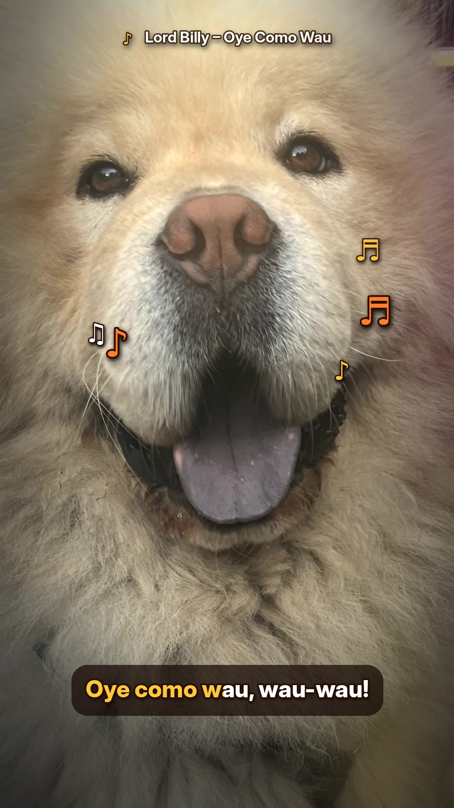

# Lord Billy – »Oye Como Wau«

Ein 45-Sekunden-Musikvideo mit **Billy**, unserem Chow-Chow (Rüde, 6 Jahre).
Billy singt darin einen Latin-Rock-Song à la Santana, mit Am7–D9-Vamp,
Cha-Cha-Groove, Congas, Hammond-Orgel und singender Leadgitarre.

<p align="center"></p>

▶️ **Video:** [`video/LordBilly_OyeComoWau.mp4`](video/LordBilly_OyeComoWau.mp4)
(1080×1920 Hochformat, 30 fps, 45 s, mit Ton)

## Inhalt

| Pfad | Was |
|---|---|
| `video/LordBilly_OyeComoWau.mp4` | das fertige Musikvideo mit eingebrannten Karaoke-Untertiteln |
| `video/LordBilly_OyeComoWau.srt` | die gesungenen Zeilen zusätzlich als Untertiteldatei |
| `video/poster.jpg` | Vorschaubild |
| `audio/LordBilly_OyeComoWau.mp3` | nur der Song |
| `bilder/` | die drei Originalfotos von Billy (aus Google Drive › GitHub › LordBilly) |
| `src/` | Programme, mit denen Song und Video erzeugt werden |

## Das Video

- **0–4 s:** Titel: Billy im Park
- **4–12 s:** Gitarren-Intro, Billy wärmt die Stimme auf (»Au-uuu?«)
- **12–28 s:** Strophe: Billy singt, das Maul bewegt sich synchron zu jeder Silbe
- **28–36 s:** Refrain »Oye como wau, wau-wau!«
- **36–42 s:** Gitarrensolo mit schnellen Schnitten, Billy heult mit
- **42–45 s:** Finale »Wau-uuuuuh!« und Abspann

Unten im Bild steht immer die Zeile, die Billy gerade singt. Die schon
gesungenen Silben färben sich dabei gold (Karaoke-Stil).

## Liedtext

> Oye, mein Name ist Billy,
> ein Chow Chow mit Löwenmähne.
> Sechs Jahre Sonne im Fell,
> die Zunge so blau wie die Nacht.
>
> Oye como wau, wau-wau!
> Lord Billy singt für dich – auuu!

## Hinweis zur Musik

Ein echter Santana-Song ist urheberrechtlich geschützt, und Aufnahmen davon
standen hier nicht zur Verfügung. Melodie, Text und Arrangement sind deshalb
eine **Eigenkomposition im Santana-Stil**. Das Wortspiel im Titel ist eine
Hommage. Alle Klänge entstehen per Synthese in `src/make_song.py`, auch
Billys Gesangsstimme (Formant-Synthese). Es wurden keine Samples oder
fremden Aufnahmen verwendet.

## Selbst neu erzeugen

Voraussetzungen: Python 3 mit `numpy`, `scipy`, `opencv-python-headless`,
`Pillow` sowie `ffmpeg` und die Schrift *Inter*.

```bash
pip install numpy scipy opencv-python-headless Pillow
mkdir -p build
python3 src/make_song.py build/song.wav
python3 src/make_video.py build/song.wav video/LordBilly_OyeComoWau.mp4
```

- `src/timeline.py`: Tempo, Melodie, Liedtext, Gitarrenlinie und die daraus
  berechnete Maulöffnung (gemeinsamer Zeitplan für Ton und Bild)
- `src/make_song.py`: Percussion, Bass, Orgel, Gitarre, Gesang, Mix
- `src/make_video.py`: Kamerafahrten über die Fotos, Unterkiefer-Animation,
  Lichteffekte, fliegende Noten, Titel und Karaoke-Untertitel

Einzelne Vorschaubilder: `python3 src/make_video.py --preview 13.1,29.3 vorschau/`
